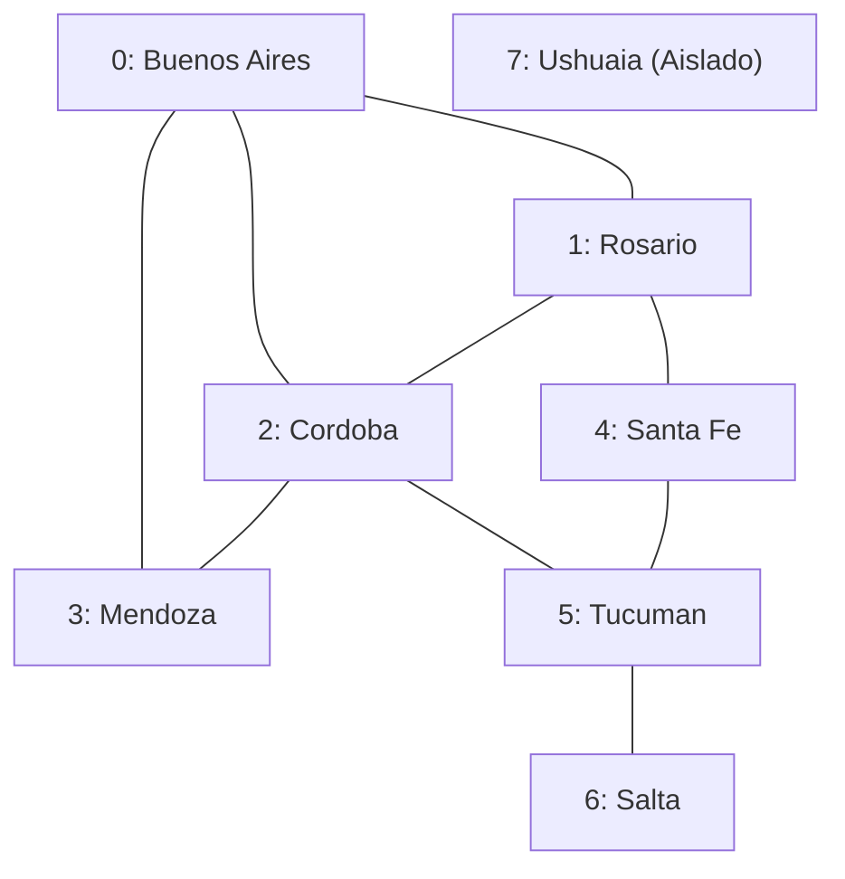

# Trabajo Práctico Integrador — TDA Grafo (Grupo 4)

**Materia:** Algoritmos y Estructuras de Datos II  
**Integración de TDAs:** `Grafo`, `Cola` (TP1), `Pila` (TP1) y `Diccionario` (TP2)  
**Lenguaje:** Java 17

---

## Estructura del Proyecto

El código fuente se encuentra en `src/main/java/com/example/tp4/` y está compuesto por las siguientes clases (sin utilizar `java.util.HashMap` ni ninguna colección de la biblioteca estándar de Java):

- [`Pila.java`](src/main/java/com/example/tp4/Pila.java): TDA Pila genérica reutilizada de TP1 (implementación dinámica con nodos enlazados, operaciones en $O(1)$).
- [`Cola.java`](src/main/java/com/example/tp4/Cola.java): TDA Cola genérica reutilizada de TP1 (implementación dinámica con punteros a frente y fondo, operaciones en $O(1)$).
- [`Diccionario.java`](src/main/java/com/example/tp4/Diccionario.java): TDA Diccionario Simple reutilizado de TP2 (tabla de dispersión abierta con encadenamiento propio, operaciones en $O(1)$ promedio).
- [`Grafo.java`](src/main/java/com/example/tp4/Grafo.java): Implementación del TDA Grafo no dirigido y no pesado sobre **matriz de adyacencia** booleana de tamaño $n \times n$, utilizando el TDA `Diccionario` para traducir etiquetas (`String`) a índices internos (`0 .. n-1`).
- [`Main.java`](src/main/java/com/example/tp4/Main.java): Implementación de los recorridos de la **Parte 3** (`bfs`, `dfs`, `dfsIterativo`), los algoritmos de utilización de la **Parte 4** (`estanConectados`, `componentesConexas`, `caminoMasCorto`) y el método `main()` que construye el grafo de ejemplo y ejecuta todas las pruebas por consola.

---

## Parte 1 — Especificación del TDA Grafo

### Dominio
Un **Grafo** $G = (V, A)$ no dirigido, simple y no pesado con capacidad acotada $n \in \mathbb{N}$ ($n > 0$), donde:
- $V$ es un conjunto finito de vértices identificados unívocamente por una etiqueta (`String`), con $|V| \le n$.
- $A \subseteq \{\{u, v\} \mid u, v \in V\}$ es un conjunto de pares no ordenados de vértices que representan las aristas sin dirección ni peso entre ellos (la relación de adyacencia es simétrica: si $(u, v) \in A$, entonces $(v, u) \in A$).

---

### Operaciones (Signatura, Precondiciones y Postcondiciones)

#### 1. `crear(n: entero): Grafo`
- **Signatura:** $\text{crear}: \text{entero} \rightarrow \text{Grafo}$
- **Precondición:** $n > 0$ (la capacidad máxima de vértices debe ser un entero positivo).
- **Postcondición:** Devuelve un grafo $g$ vacío, sin vértices ($|V| = 0$) ni aristas ($|A| = 0$), con capacidad máxima para almacenar hasta $n$ vértices.

#### 2. `agregarVertice(g: Grafo, etiqueta: String): Grafo`
- **Signatura:** $\text{agregarVertice}: \text{Grafo} \times \text{String} \rightarrow \text{Grafo}$
- **Precondición:**
  1. `etiqueta` no es nula ni vacía.
  2. El grafo **no alcanzó su capacidad máxima**: $\text{cantidadVertices}(g) < n$. *(Si ya tiene $n$ vértices, no hay fila/columna disponible en la matriz estática de tamaño $n \times n$ y la operación es inválida).*
  3. La etiqueta **no pertenece ya al grafo**: $\neg\text{existeVertice}(g, \text{etiqueta})$. *(No se permiten dos vértices con la misma etiqueta).*
- **Postcondición:** Devuelve el grafo $g$ con el nuevo vértice `etiqueta` incorporado a su conjunto de vértices $V$, inicialmente aislado (sin aristas incidentes), incrementando en $1$ el valor de $\text{cantidadVertices}(g)$.

#### 3. `agregarArista(g: Grafo, v1: String, v2: String): Grafo`
- **Signatura:** $\text{agregarArista}: \text{Grafo} \times \text{String} \times \text{String} \rightarrow \text{Grafo}$
- **Precondición:** Ambos vértices `v1` y `v2` **deben pertenecer al grafo** ($\text{existeVertice}(g, v_1) \land \text{existeVertice}(g, v_2)$). *(Si alguno de los vértices mencionados no fue previamente agregado al grafo, no posee índice en la estructura y la operación no puede ejecutarse).*
- **Postcondición:** Devuelve el grafo $g$ con la arista no dirigida $\{v_1, v_2\}$ registrada, de modo que $\text{existeArista}(g, v_1, v_2) = \text{true}$ y $\text{existeArista}(g, v_2, v_1) = \text{true}$. Si la arista ya existía, el grafo no sufre cambios adicionales.

#### 4. `existeArista(g: Grafo, v1: String, v2: String): boolean`
- **Signatura:** $\text{existeArista}: \text{Grafo} \times \text{String} \times \text{String} \rightarrow \text{boolean}$
- **Precondición:** Ambos vértices `v1` y `v2` **deben pertenecer al grafo** ($\text{existeVertice}(g, v_1) \land \text{existeVertice}(g, v_2)$).
- **Postcondición:** Devuelve `true` si existe una arista entre `v1` y `v2` (que por simetría equivale a que exista entre `v2` y `v1`), y `false` en caso contrario. No modifica el grafo.

#### 5. `vecinos(g: Grafo, v: String): Conjunto<String>`
- **Signatura:** $\text{vecinos}: \text{Grafo} \times \text{String} \rightarrow \text{Conjunto}\langle\text{String}\rangle$
- **Precondición:** El vértice `v` **debe pertenecer al grafo** ($\text{existeVertice}(g, v)$).
- **Postcondición:** Devuelve el conjunto de todas las etiquetas $u \in V$ tales que $\text{existeArista}(g, v, u) = \text{true}$. Si $v$ no tiene aristas incidentes, devuelve un conjunto vacío. No modifica el grafo.

#### 6. `cantidadVertices(g: Grafo): entero`
- **Signatura:** $\text{cantidadVertices}: \text{Grafo} \rightarrow \text{entero}$
- **Precondición:** Ninguna (el grafo $g$ fue inicializado).
- **Postcondición:** Devuelve la cantidad actual de vértices presentes en el grafo ($0 \le \text{cantidadVertices}(g) \le n$). No modifica el grafo.

#### Operaciones observadoras auxiliares (para preservar el encapsulamiento)
- **`existeVertice(g: Grafo, v: String): boolean`**
  - *Precondición:* Ninguna.
  - *Postcondición:* Devuelve `true` si la etiqueta `v` pertenece al conjunto de vértices del grafo, `false` en caso contrario.
- **`vertices(g: Grafo): Conjunto<String>`**
  - *Precondición:* Ninguna.
  - *Postcondición:* Devuelve el conjunto de etiquetas de todos los vértices actualmente cargados en el grafo.

---

## Parte 2 — Implementación y Análisis

### 2.1 Análisis de complejidad espacial

En nuestra implementación ([`Grafo.java`](src/main/java/com/example/tp4/Grafo.java)), el grafo con capacidad para $n$ vértices utiliza:
1. **`matrizAdyacencia` (`boolean[n][n]`)**: Un arreglo bidimensional de $n$ filas por $n$ columnas, que almacena exactamente $n \times n = n^2$ valores booleanos.
2. **`indicesPorEtiqueta` (`Diccionario<String, Integer>`)**: Almacena a lo sumo $n$ pares `(etiqueta -> índice)`, ocupando espacio lineal $O(n)$.
3. **`etiquetasPorIndice` (`String[n]`)**: Arreglo de tamaño $n$ para realizar la traducción inversa (`índice -> etiqueta`) en $O(1)$, ocupando espacio lineal $O(n)$.

Sumando todas las estructuras internas:
$$S(n) = \Theta(n^2) + O(n) + O(n) = \Theta(n^2)$$

**Justificación:** La complejidad espacial del TDA Grafo implementado con matriz de adyacencia es **cuadrática respecto a la cantidad de vértices, $O(n^2)$** (y más específicamente $\Theta(n^2)$), ya que al momento de ejecutar `crear(n)` se reserva en memoria una grilla contigua de $n \times n$ celdas independientemente de cuántas aristas tenga el grafo.

#### ¿Qué ocurre con el espacio ocupado si el grafo es "disperso" (muchos vértices y pocas aristas)?
Un grafo **disperso** (o *ralo*) es aquel donde la cantidad de aristas $m = |A|$ es mucho menor que la cantidad máxima posible de aristas $\frac{n(n-1)}{2}$ (es decir, $m \ll n^2$, típicamente $m = O(n)$).
- En una matriz de adyacencia, **el espacio ocupado sigue siendo $\Theta(n^2)$ fijo**, sin importar qué tan pocas aristas existan.
- Como cada arista no dirigida ocupa solo $2$ celdas con valor `true` (`matriz[i][j]` y `matriz[j][i]`), en un grafo disperso habrán $2m$ celdas en `true` y $n^2 - 2m$ celdas en `false`.
- **Consecuencia:** Se produce un **gran desperdicio de memoria**. Por ejemplo, si $n = 10\,000$ vértices y solo hay $m = 15\,000$ aristas, la matriz reserva $100\,000\,000$ ($10^8$) de posiciones booleanas de las cuales el **$99{,}97\%$ contienen `false`**, almacenando información de *no-conexión*.

---

### 2.2 Discusión conceptual: Matriz de Adyacencia vs. Listas de Adyacencia

#### Descripción conceptual de las Listas de Adyacencia
En lugar de reservar una fila de $n$ booleanos para cada vértice, la representación mediante **listas de adyacencia** mantiene, para cada vértice $v \in V$, una colección dinámica (un TDA `Lista` o un TDA `Diccionario` de vecinos) que almacena **únicamente los vértices que son efectivamente adyacentes a $v$**.
- Podemos pensarlo como un `Diccionario<String, Lista<String>>` (o un arreglo de tamaño $n$ donde cada posición $i$ apunta a una `Lista<String>` con los vecinos del vértice $i$).
- Si el grafo es no dirigido y tiene $m$ aristas, la suma de las longitudes de todas las listas de vecinos es $\sum_{v \in V} \text{grado}(v) = 2m$.

#### Comparación entre ambas representaciones

Sea $n = |V|$ la cantidad de vértices, $m = |A|$ la cantidad de aristas y $g(v) = \text{grado}(v)$ la cantidad de vecinos del vértice $v$ (con $0 \le g(v) < n$):

| Criterio / Operación | Matriz de Adyacencia | Listas de Adyacencia (con TDA Lista por vértice) | Listas de Adyacencia (con TDA Diccionario/Hash por vértice) |
| :--- | :---: | :---: | :---: |
| **Espacio ocupado** | $\Theta(n^2)$ | $\Theta(n + m)$ | $\Theta(n + m)$ |
| **`existeArista(g, v1, v2)`** | **$O(1)$** *(acceso directo a `matriz[i][j]`)* | $O(\text{grado}(v_1)) \subseteq O(n)$ *(recorrido secuencial de la lista de $v_1$)* | $O(1)$ promedio *(búsqueda por clave en el diccionario de vecinos de $v_1$)* |
| **`vecinos(g, v)`** | **$\Theta(n)$** *(debe escanear las $n$ columnas de la fila de $v$)* | **$\Theta(\text{grado}(v))$** *(solo recorre los vecinos reales de $v$)* | **$\Theta(\text{grado}(v))$** *(solo recorre las claves vecinas de $v$)* |

#### Análisis detallado de costos
1. **Espacio ocupado:**
   - **Matriz:** $\Theta(n^2)$, depende exclusivamente de la capacidad de vértices $n$.
   - **Listas:** $\Theta(n + m)$, proporcional a la cantidad de vértices más la cantidad real de aristas. En grafos dispersos ($m = O(n)$), ahorra un orden de magnitud completo de memoria ($O(n)$ vs $O(n^2)$).
2. **Costo de `existeArista(g, v1, v2)`:**
   - **Matriz:** Traduce `v1` y `v2` a sus índices $i, j$ en $O(1)$ promedio con el `Diccionario` y consulta `matriz[i][j]` en **$O(1)$**. Es insuperable en velocidad de consulta puntual.
   - **Listas:** Tras ubicar el vértice `v1` en $O(1)$, si sus vecinos están en un TDA `Lista`, debe recorrerla linealmente hasta encontrar `v2` o llegar al final, costando $O(\text{grado}(v_1))$ (que en el peor caso es $O(n)$). Si en cambio cada vértice guarda sus vecinos en un TDA `Diccionario` (hash), también puede resolverse en $O(1)$ promedio, aunque con mayor sobrecarga de memoria constante por nodo.
3. **Costo de `vecinos(g, v)`:**
   - **Matriz:** Incluso si el vértice $v$ está aislado ($\text{grado}(v) = 0$), el método está obligado a recorrer las $n$ posiciones de su fila `matriz[i][0 .. n-1]` para verificar cuáles son `true`. Por lo tanto, siempre cuesta **$\Theta(n)$**.
   - **Listas:** Solo recorre los elementos presentes en la lista de $v$, por lo que cuesta **$\Theta(\text{grado}(v))$**. Si $v$ no tiene vecinos, cuesta $O(1)$. Esto hace que recorrer todo el grafo (BFS/DFS) cueste $O(n + m)$ en lugar de $O(n^2)$.

#### ¿En qué escenario conviene cada una?
- **Conviene Matriz de Adyacencia cuando:**
  - El **grafo es denso** ($m \approx n^2$), ya que casi todas las celdas de la matriz se aprovechan y se evita el *overhead* de punteros/nodos de las listas enlazadas.
  - La cantidad de vértices $n$ es **pequeña o moderada y conocida de antemano**.
  - La operación más frecuente del problema es verificar rápidamente si dos vértices cualesquiera están conectados (`existeArista` en $O(1)$).
- **Conviene Listas de Adyacencia cuando:**
  - El **grafo es disperso / ralo** ($m \ll n^2$), que es el caso más común en problemas reales (mapas de rutas donde cada ciudad conecta con 3 o 4 ciudades vecinas, redes de amistad, páginas web).
  - La cantidad de vértices $n$ es grande o crece dinámicamente.
  - Los algoritmos predominantes son **recorridos de grafos (BFS, DFS, caminos mínimos, componentes conexas)** donde se invoca intensivamente `vecinos(g, v)`, logrando complejidad $O(n + m)$ en vez de $O(n^2)$.

---

## Descripción del Grafo de Ejemplo (Partes 3 y 4)

Para las Partes 3 y 4 construimos en `Main.construirGrafoEjemplo()` un grafo no dirigido de **$n = 8$ ciudades de Argentina** conectadas por rutas directas ($m = 9$ aristas), dividido en **2 componentes conexas**:
1. **Componente conexa principal (7 ciudades continentales):** `"Buenos Aires"`, `"Rosario"`, `"Cordoba"`, `"Mendoza"`, `"Santa Fe"`, `"Tucuman"` y `"Salta"`.
2. **Componente conexa aislada (1 ciudad insular):** `"Ushuaia"` (sin aristas terrestres directas en este grafo, cumpliendo lo pedido en la Parte 4.2).



### Vértices e índices internos en el `Diccionario`
| Índice | Etiqueta del Vértice | Vecinos directos (`vecinos(g, v)`) | Grado |
| :---: | :--- | :--- | :---: |
| `0` | `"Buenos Aires"` | `{"Rosario", "Cordoba", "Mendoza"}` | 3 |
| `1` | `"Rosario"` | `{"Buenos Aires", "Cordoba", "Santa Fe"}` | 3 |
| `2` | `"Cordoba"` | `{"Buenos Aires", "Rosario", "Mendoza", "Tucuman"}` | 4 |
| `3` | `"Mendoza"` | `{"Buenos Aires", "Cordoba"}` | 2 |
| `4` | `"Santa Fe"` | `{"Rosario", "Tucuman"}` | 2 |
| `5` | `"Tucuman"` | `{"Cordoba", "Santa Fe", "Salta"}` | 3 |
| `6` | `"Salta"` | `{"Tucuman"}` | 1 |
| `7` | `"Ushuaia"` | `{}` *(sin aristas)* | 0 |

### Aristas ($9$ conexiones bidireccionales)
1. `Buenos Aires` — `Rosario`
2. `Buenos Aires` — `Cordoba`
3. `Buenos Aires` — `Mendoza`
4. `Rosario` — `Cordoba`
5. `Rosario` — `Santa Fe`
6. `Cordoba` — `Mendoza`
7. `Cordoba` — `Tucuman`
8. `Santa Fe` — `Tucuman`
9. `Tucuman` — `Salta`

---

## Parte 3 — Recorridos

### 3.1 BFS — Búsqueda en anchura (con TDA `Cola`)

#### Código
```java
public static String[] bfs(Grafo g, String origen) {
    if (!g.existeVertice(origen)) {
        throw new IllegalArgumentException("El vértice origen '" + origen + "' no pertenece al grafo.");
    }

    Cola<String> cola = Cola.crear();
    Diccionario<String, Boolean> visitados = Diccionario.crear();
    String[] temporal = new String[g.cantidadVertices()];
    int cantidadVisitados = 0;

    visitados.agregar(origen, true);
    cola.encolar(origen);

    while (!cola.estaVacia()) {
        String actual = cola.desencolar();
        temporal[cantidadVisitados++] = actual;

        String[] adyacentes = g.vecinos(actual);
        for (int i = 0; i < adyacentes.length; i++) {
            String vecino = adyacentes[i];
            if (!visitados.existeClave(vecino)) {
                visitados.agregar(vecino, true);
                cola.encolar(vecino);
            }
        }
    }

    return recortarArreglo(temporal, cantidadVisitados);
}
```

#### Salida por consola (partiendo de `"Buenos Aires"`)
```text
3.1 BFS (con TDA Cola):          [Buenos Aires -> Rosario -> Cordoba -> Mendoza -> Santa Fe -> Tucuman -> Salta]
```
- **Nivel 0 (distancia 0):** `Buenos Aires`
- **Nivel 1 (distancia 1):** `Rosario`, `Cordoba`, `Mendoza`
- **Nivel 2 (distancia 2):** `Santa Fe` (descubierto desde `Rosario`), `Tucuman` (descubierto desde `Cordoba`)
- **Nivel 3 (distancia 3):** `Salta` (descubierto desde `Tucuman`)

#### Complejidad temporal de BFS
- Cada vértice alcanzable (a lo sumo $n$ vértices) es encolado y desencolado en la `Cola` exactamente una vez: $O(n)$ operaciones de cola de costo $O(1)$.
- Por cada vértice desencolado, se invoca `g.vecinos(actual)`, que sobre una **matriz de adyacencia** recorre las $n$ columnas de la fila correspondiente en tiempo $\Theta(n)$, y para cada vecino verifica `visitados.existeClave(vecino)` en $O(1)$ promedio.
- **Complejidad temporal total:** **$O(n^2)$** sobre matriz de adyacencia (si el grafo estuviera representado con listas de adyacencia, sería $O(n + m)$).

---

### 3.2 DFS — Búsqueda en profundidad (recursiva)

#### Código
```java
public static String[] dfs(Grafo g, String origen) {
    if (!g.existeVertice(origen)) {
        throw new IllegalArgumentException("El vértice origen '" + origen + "' no pertenece al grafo.");
    }

    Diccionario<String, Boolean> visitados = Diccionario.crear();
    String[] temporal = new String[g.cantidadVertices()];
    int[] contador = new int[]{0};

    dfsRecursivo(g, origen, visitados, temporal, contador);

    return recortarArreglo(temporal, contador[0]);
}

private static void dfsRecursivo(
        Grafo g,
        String actual,
        Diccionario<String, Boolean> visitados,
        String[] resultado,
        int[] contador) {

    visitados.agregar(actual, true);
    resultado[contador[0]++] = actual;

    String[] adyacentes = g.vecinos(actual);
    for (int i = 0; i < adyacentes.length; i++) {
        String vecino = adyacentes[i];
        if (!visitados.existeClave(vecino)) {
            dfsRecursivo(g, vecino, visitados, resultado, contador);
        }
    }
}
```

#### Salida por consola (partiendo de `"Buenos Aires"`)
```text
3.2 DFS Recursivo:               [Buenos Aires -> Rosario -> Cordoba -> Mendoza -> Tucuman -> Santa Fe -> Salta]
```

#### Comparación del orden obtenido (DFS Recursivo vs. BFS)
- **BFS** explora **por niveles de cercanía** al origen: después de `"Buenos Aires"`, visita primero a *todos* sus vecinos directos (`"Rosario"`, `"Cordoba"`, `"Mendoza"`) antes de avanzar a ciudades a $2$ aristas de distancia (`"Santa Fe"`, `"Tucuman"`).
- **DFS Recursivo**, en cambio, apenas descubre el primer vecino de `"Buenos Aires"` (`"Rosario"`), se sumerge inmediatamente por esa rama (`"Buenos Aires" -> "Rosario" -> "Cordoba" -> "Mendoza"`). Cuando en `"Mendoza"` ya no quedan vecinos sin visitar, retrocede (*backtracking*) a `"Cordoba"` y continúa profundizando hacia `"Tucuman" -> "Santa Fe"`, y luego `"Salta"`. Por eso `"Santa Fe"` se visita mucho después en DFS que en BFS, mientras que `"Tucuman"` se visita antes que `"Santa Fe"`.

#### Complejidad temporal de DFS Recursivo
- `dfsRecursivo` se invoca a lo sumo una vez por cada uno de los $n$ vértices (gracias al control con `visitados`).
- En cada llamada recursiva, `g.vecinos(actual)` recorre una fila de longitud $n$ de la matriz de adyacencia en tiempo $\Theta(n)$.
- **Complejidad temporal total:** **$O(n^2)$** sobre matriz de adyacencia.

---

### 3.3 DFS iterativo (desafío adicional con TDA `Pila`)

#### Código
```java
public static String[] dfsIterativo(Grafo g, String origen) {
    if (!g.existeVertice(origen)) {
        throw new IllegalArgumentException("El vértice origen '" + origen + "' no pertenece al grafo.");
    }

    Pila<String> pila = Pila.crear();
    Diccionario<String, Boolean> visitados = Diccionario.crear();
    String[] temporal = new String[g.cantidadVertices()];
    int cantidadVisitados = 0;

    pila.apilar(origen);

    while (!pila.estaVacia()) {
        String actual = pila.desapilar();

        if (!visitados.existeClave(actual)) {
            visitados.agregar(actual, true);
            temporal[cantidadVisitados++] = actual;

            String[] adyacentes = g.vecinos(actual);
            for (int i = 0; i < adyacentes.length; i++) {
                String vecino = adyacentes[i];
                if (!visitados.existeClave(vecino)) {
                    pila.apilar(vecino);
                }
            }
        }
    }

    return recortarArreglo(temporal, cantidadVisitados);
}
```

#### Salida por consola (partiendo de `"Buenos Aires"`)
```text
3.3 DFS Iterativo (con TDA Pila):[Buenos Aires -> Mendoza -> Cordoba -> Tucuman -> Salta -> Santa Fe -> Rosario]
```

#### Comparación contra el DFS recursivo (3.2): ¿Es exactamente el mismo orden? Justificación
- **Respuesta:** **No es exactamente el mismo orden** (aunque **ambos son recorridos en profundidad (DFS) completamente válidos**).
- **Justificación de por qué ocurre:**
  1. En el **DFS recursivo (3.2)**, al iterar sobre el arreglo `g.vecinos("Buenos Aires")` = `["Rosario", "Cordoba", "Mendoza"]` desde el índice `0` hacia adelante, apenas se inspecciona el **primer** vecino (`"Rosario"`), se realiza la llamada recursiva inmediata sobre `"Rosario"`, postergando a `"Cordoba"` y `"Mendoza"`. Por lo tanto, explora las ramas de **izquierda a derecha** (primero el vecino de menor índice).
  2. En el **DFS iterativo (3.3)** con el TDA `Pila`, al visitar `"Buenos Aires"` se apilan en el ciclo `for` todos sus vecinos en orden: primero se apila `"Rosario"`, luego `"Cordoba"` y por último `"Mendoza"`. Como la `Pila` tiene política **LIFO (*Last-In, First-Out*: el último en entrar es el primero en salir)**, `"Mendoza"` queda en el **tope de la pila** y es el primer vértice en desapilarse en la siguiente iteración, profundizando por `"Mendoza" -> "Cordoba" -> "Tucuman" -> "Salta" -> "Santa Fe" -> "Rosario"` (explora las ramas de **derecha a izquierda**, es decir, primero el vecino de mayor índice).
  *(Nota: Si se quisiera que el DFS iterativo produjera exactamente la misma secuencia que el DFS recursivo, bastaría con apilar los vecinos en orden inverso, desde `adyacentes.length - 1` hasta `0`).*

#### Complejidad temporal de DFS Iterativo
- Cada vértice se marca como visitado e ingresa al bloque de exploración de vecinos a lo sumo una vez ($O(n)$ veces), donde `g.vecinos(actual)` cuesta $\Theta(n)$ sobre la matriz de adyacencia. Cada arista puede generar a lo sumo un `apilar` y un `desapilar` de costo $O(1)$.
- **Complejidad temporal total:** **$O(n^2)$** sobre matriz de adyacencia.

---

## Parte 4 — Utilización

### 4.1 `estanConectados(g: Grafo, v1, v2): boolean`

#### Código
```java
public static boolean estanConectados(Grafo g, String v1, String v2) {
    if (!g.existeVertice(v1) || !g.existeVertice(v2)) {
        throw new IllegalArgumentException("Ambos vértices deben pertenecer al grafo.");
    }
    if (v1.equals(v2)) {
        return true;
    }

    String[] alcanzables = bfs(g, v1);
    for (int i = 0; i < alcanzables.length; i++) {
        if (alcanzables[i].equals(v2)) {
            return true;
        }
    }
    return false;
}
```

#### Justificación: ¿Qué recorrido se usó y por qué es indistinto usar BFS o DFS?
- Se utilizó **BFS** (`bfs(g, v1)`), pero para el problema de determinar si dos vértices están conectados (**alcanzabilidad**) es **totalmente indistinto usar BFS o DFS**:
  1. **Mismo conjunto de vértices alcanzados:** Tanto BFS como DFS son algoritmos de búsqueda exhaustiva sobre la componente conexa del vértice origen `v1`. Aunque difieren en el *orden* en que visitan los vértices (por niveles vs. en profundidad), al finalizar ambos visitan **exactamente el mismo subconjunto de vértices**: todos aquellos para los cuales existe al menos un camino desde `v1`.
  2. **Misma complejidad asintótica:** En el peor caso (por ejemplo, cuando `v2` es el último vértice visitado o cuando no existe camino entre `v1` y `v2`), tanto BFS como DFS deben recorrer toda la componente conexa de `v1`, teniendo ambos una complejidad temporal de **$O(n^2)$** sobre matriz de adyacencia.

#### Complejidad temporal
- Ejecutar `bfs(g, v1)` cuesta $O(n^2)$ y buscar linealmente `v2` en el arreglo de vértices alcanzados (de tamaño a lo sumo $n$) cuesta $O(n)$.
- **Complejidad temporal total:** **$O(n^2)$**.

#### Salida de ejemplo
```text
4.1 estanConectados:
  - ¿'Buenos Aires' y 'Salta' estan conectados?:   true (esperado: true)
  - ¿'Mendoza' y 'Santa Fe' estan conectados?:     true (esperado: true)
  - ¿'Buenos Aires' y 'Ushuaia' estan conectados?: false (esperado: false)
```

---

### 4.2 `componentesConexas(g: Grafo): entero`

#### Código
```java
public static int componentesConexas(Grafo g) {
    String[] todosLosVertices = g.vertices();
    Diccionario<String, Boolean> visitados = Diccionario.crear();
    int cantidadComponentes = 0;

    for (int i = 0; i < todosLosVertices.length; i++) {
        String vertice = todosLosVertices[i];
        if (!visitados.existeClave(vertice)) {
            cantidadComponentes++;
            String[] alcanzablesEnComponente = bfs(g, vertice);
            for (int j = 0; j < alcanzablesEnComponente.length; j++) {
                visitados.agregar(alcanzablesEnComponente[j], true);
            }
        }
    }

    return cantidadComponentes;
}
```

#### Complejidad temporal
- Aunque hay un ciclo externo que itera sobre los $n$ vértices del grafo, la llamada a `bfs(g, vertice)` **solo se ejecuta cuando `vertice` aún no fue visitado** (es decir, exactamente una vez por cada componente conexa $C_k$).
- Si la componente conexa $C_k$ tiene $n_k$ vértices, el recorrido sobre $C_k$ explora únicamente las filas de la matriz correspondientes a esos $n_k$ vértices, costando $O(n_k \cdot n)$.
- Como las componentes conexas forman una partición del conjunto de vértices ($\sum_{k} n_k = n$), el costo total acumulado en todo el algoritmo es:
  $$\sum_{k} O(n_k \cdot n) = O\left(n \cdot \sum_{k} n_k\right) = O(n \cdot n) = O(n^2)$$
- **Complejidad temporal total:** **$O(n^2)$**.

#### Salida de ejemplo
```text
4.2 componentesConexas:
  - Cantidad de componentes conexas del grafo: 2 (Comp. 1: red continental de 7 ciudades | Comp. 2: Ushuaia aislada)
```

---

### 4.3 `caminoMasCorto(g: Grafo, origen, destino): entero`

#### Código
```java
public static int caminoMasCorto(Grafo g, String origen, String destino) {
    if (!g.existeVertice(origen) || !g.existeVertice(destino)) {
        throw new IllegalArgumentException("Tanto el origen como el destino deben pertenecer al grafo.");
    }
    if (origen.equals(destino)) {
        return 0;
    }

    Cola<String> cola = Cola.crear();
    Diccionario<String, Integer> distancias = Diccionario.crear();

    distancias.agregar(origen, 0);
    cola.encolar(origen);

    while (!cola.estaVacia()) {
        String actual = cola.desencolar();
        int distanciaActual = distancias.obtener(actual);

        if (actual.equals(destino)) {
            return distanciaActual;
        }

        String[] adyacentes = g.vecinos(actual);
        for (int i = 0; i < adyacentes.length; i++) {
            String vecino = adyacentes[i];
            if (!distancias.existeClave(vecino)) {
                distancias.agregar(vecino, distanciaActual + 1);
                cola.encolar(vecino);
            }
        }
    }

    return -1; // Indica que no existe camino entre origen y destino
}
```

#### Justificación: ¿Por qué BFS garantiza el camino con menor cantidad de aristas en un grafo no pesado?
- En un grafo no pesado, la longitud de un camino es simplemente la **cantidad de aristas** que lo componen.
- El recorrido **BFS** utiliza una **Cola FIFO (*First-In, First-Out*)**, lo cual mantiene el invariante de que los vértices se encolan y procesan en **orden monótono creciente de su distancia (en aristas) al vértice `origen`**:
  1. Primero se procesa el nivel $0$ (únicamente `origen`, a distancia $0$).
  2. Al procesar el nivel $0$, se descubren y encolan todos los vértices a distancia $1$ (vecinos directos de `origen`).
  3. Gracias al orden FIFO de la `Cola`, ningún vértice de distancia $2$ puede ser desencolado antes de que se hayan terminado de desencolar todos los vértices de distancia $1$. En general, **todos los vértices a distancia $k$ se descubren y encolan antes que cualquier vértice a distancia $k + 1$**.
- Por inducción sobre $k$, la **primera vez** que un vértice $v$ es alcanzado y registrado en el diccionario `distancias`, se llega a él desde un vértice de nivel $k - 1$ mediante un camino de exactamente $k$ aristas, y no puede existir ningún camino de longitud menor a $k$ (pues de haber existido, $v$ habría sido descubierto en una capa anterior). Por el contrario, DFS podría encontrar primero un camino largo dando un rodeo antes de explorar una arista directa.

#### Complejidad temporal
- Al igual que el BFS estándar, cada vértice se encola/desencola a lo sumo una vez ($O(n)$), las consultas y registros en el diccionario `distancias` cuestan $O(1)$ promedio, y obtener los vecinos desde la matriz de adyacencia cuesta $\Theta(n)$ por cada vértice procesado.
- **Complejidad temporal total:** **$O(n^2)$** en el peor caso sobre matriz de adyacencia.

#### Salida de ejemplo
```text
4.3 caminoMasCorto (en cantidad de aristas, usando BFS):
  - Camino mas corto 'Buenos Aires' -> 'Buenos Aires': 0 aristas
  - Camino mas corto 'Buenos Aires' -> 'Cordoba':      1 arista (ruta directa)
  - Camino mas corto 'Buenos Aires' -> 'Tucuman':      2 aristas (Buenos Aires -> Cordoba -> Tucuman)
  - Camino mas corto 'Buenos Aires' -> 'Salta':        3 aristas (Buenos Aires -> Cordoba -> Tucuman -> Salta)
  - Camino mas corto 'Buenos Aires' -> 'Ushuaia':      -1 (no existe camino)
```

---

## Resumen de Complejidades Temporales

| Operación / Método | Complejidad Temporal (Matriz de Adyacencia) | Justificación breve |
| :--- | :---: | :--- |
| `Grafo.crear(n)` | $O(n^2)$ | Inicialización de la matriz booleana de $n \times n$. |
| `Grafo.agregarVertice(g, etiqueta)` | $O(1)$ promedio | Inserción de la etiqueta en el `Diccionario` (hash) y en el arreglo de etiquetas. |
| `Grafo.agregarArista(g, v1, v2)` | $O(1)$ promedio | Búsqueda de índices en `Diccionario` ($O(1)$) y asignación en `matriz[i][j]` y `matriz[j][i]`. |
| `Grafo.existeArista(g, v1, v2)` | $O(1)$ promedio | Búsqueda de índices en `Diccionario` ($O(1)$) y lectura directa de `matriz[i][j]`. |
| `Grafo.vecinos(g, v)` | $\Theta(n)$ | Recorrido completo de la fila de tamaño $n$ correspondiente al vértice $v$. |
| `Grafo.cantidadVertices(g)` | $O(1)$ | Retorno del atributo contador `cantidadActual`. |
| **3.1** `bfs(g, origen)` | $O(n^2)$ | A lo sumo $n$ vértices desencolados; para cada uno, `vecinos` cuesta $O(n)$. |
| **3.2** `dfs(g, origen)` *(recursivo)* | $O(n^2)$ | A lo sumo $n$ llamadas recursivas; para cada vértice visitado, `vecinos` cuesta $O(n)$. |
| **3.3** `dfsIterativo(g, origen)` | $O(n^2)$ | A lo sumo $n$ vértices expandidos desde la `Pila`; para cada uno, `vecinos` cuesta $O(n)$. |
| **4.1** `estanConectados(g, v1, v2)` | $O(n^2)$ | Ejecuta un recorrido `bfs(g, v1)` de costo $O(n^2)$ y busca `v2` en $O(n)$. |
| **4.2** `componentesConexas(g)` | $O(n^2)$ | Cada vértice es visitado y su fila de tamaño $n$ es inspeccionada exactamente una vez en total. |
| **4.3** `caminoMasCorto(g, orig, dest)` | $O(n^2)$ | Recorrido BFS acumulando distancias por nivel en un `Diccionario` en $O(1)$ por vecino. |

---

## Salida Completa de `Main.main()`

```text
======================================================================
          TRABAJO PRACTICO INTEGRADOR - TDA GRAFO (GRUPO 4)           
======================================================================

--- PARTE 1 y 2: Operaciones basicas del TDA Grafo ---
Cantidad de vertices actuales: 8
Vertices del grafo: {Buenos Aires, Rosario, Cordoba, Mendoza, Santa Fe, Tucuman, Salta, Ushuaia}
¿Existe arista (Buenos Aires - Cordoba)?: true
¿Existe arista (Buenos Aires - Salta)?: false
Vecinos de 'Buenos Aires': {Rosario, Cordoba, Mendoza}
Vecinos de 'Cordoba':      {Buenos Aires, Rosario, Mendoza, Tucuman}
Vecinos de 'Ushuaia':      {}

--- PARTE 3: Recorridos del Grafo (Origen: 'Buenos Aires') ---
3.1 BFS (con TDA Cola):          [Buenos Aires -> Rosario -> Cordoba -> Mendoza -> Santa Fe -> Tucuman -> Salta]
3.2 DFS Recursivo:               [Buenos Aires -> Rosario -> Cordoba -> Mendoza -> Tucuman -> Santa Fe -> Salta]
3.3 DFS Iterativo (con TDA Pila):[Buenos Aires -> Mendoza -> Cordoba -> Tucuman -> Salta -> Santa Fe -> Rosario]

--- PARTE 4: Utilizacion del TDA Grafo ---
4.1 estanConectados:
  - ¿'Buenos Aires' y 'Salta' estan conectados?:   true (esperado: true)
  - ¿'Mendoza' y 'Santa Fe' estan conectados?:     true (esperado: true)
  - ¿'Buenos Aires' y 'Ushuaia' estan conectados?: false (esperado: false)

4.2 componentesConexas:
  - Cantidad de componentes conexas del grafo: 2 (Comp. 1: red continental de 7 ciudades | Comp. 2: Ushuaia aislada)

4.3 caminoMasCorto (en cantidad de aristas, usando BFS):
  - Camino mas corto 'Buenos Aires' -> 'Buenos Aires': 0 aristas
  - Camino mas corto 'Buenos Aires' -> 'Cordoba':      1 arista (ruta directa)
  - Camino mas corto 'Buenos Aires' -> 'Tucuman':      2 aristas (Buenos Aires -> Cordoba -> Tucuman)
  - Camino mas corto 'Buenos Aires' -> 'Salta':        3 aristas (Buenos Aires -> Cordoba -> Tucuman -> Salta)
  - Camino mas corto 'Buenos Aires' -> 'Ushuaia':      -1 (no existe camino)
======================================================================
```
